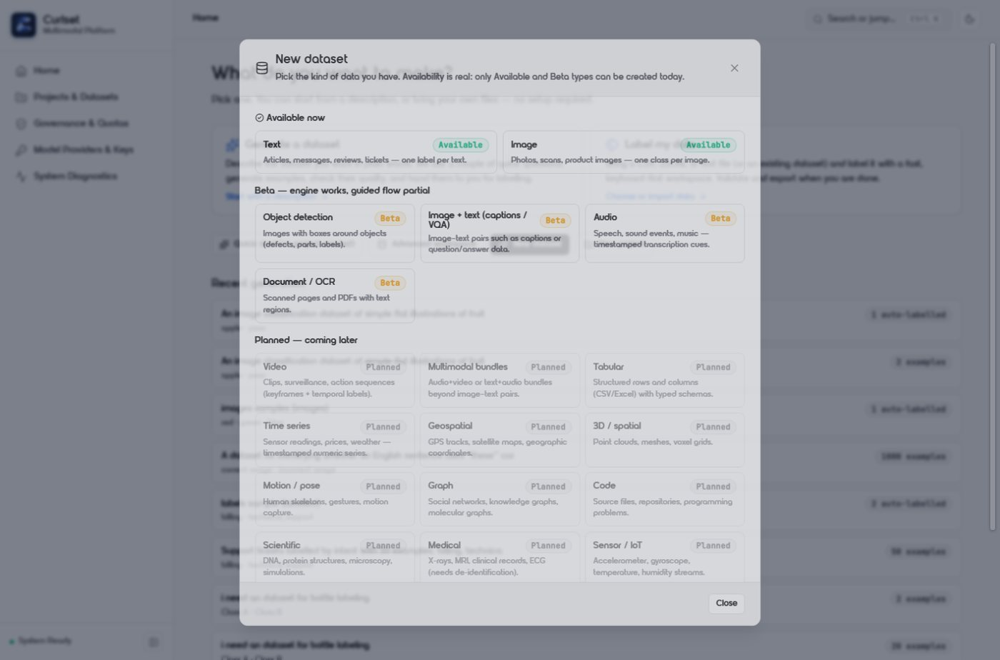
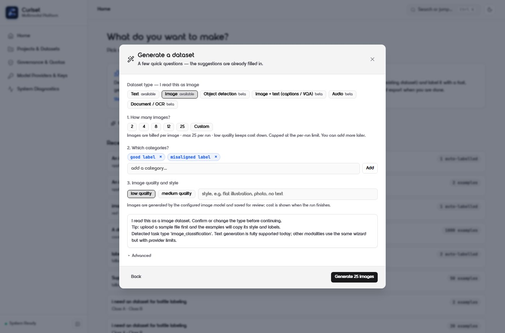
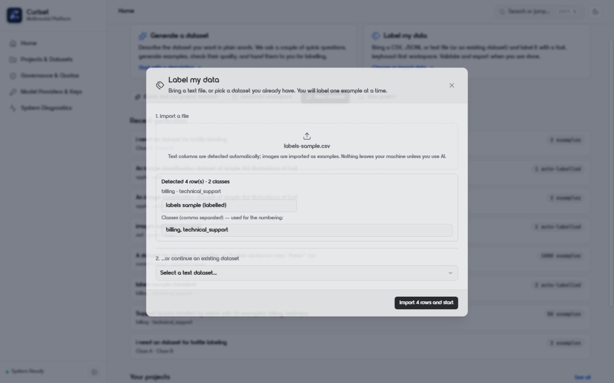
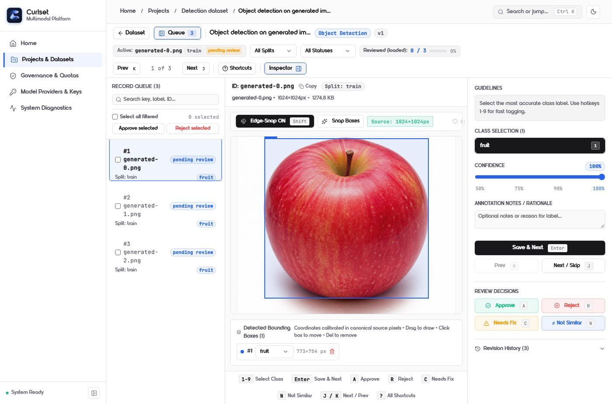

# Curlset — AI Dataset Engineering Platform

<p align="center"></p>

<p align="center">
  <a href="https://github.com/cyberkunju/curlset/actions/workflows/ci.yml"></a>
  
  
  
</p>

Curlset is a local-first workbench for turning raw data into **reviewed, validated, versioned and
exportable training datasets**. Generation and labeling are inputs; the dataset, its provenance and its
evidence are the product.

It is built for the unglamorous part of ML: normalizing inconsistent files, keeping machine output
distinguishable from human decisions, catching leakage and duplicates, pinning an immutable version and
exporting something a trainer can actually consume.

## What works today

| Area | Status |
|---|---|
| Dataset types | 21-type catalogue: **2 available** (text, image), **4 beta** (object detection, image+text, audio, document/OCR), 15 planned — [details](docs/MODALITIES.md) |
| Ingestion | CSV, JSONL, JSON, TXT, images, audio where parseable, PDF text, ZIP; duplicate detection and upload safety limits |
| Generation | Synthetic text datasets with plan → questions → measured-ETA jobs; sample-guided analysis; image datasets via OpenAI `gpt-image-2` / Meta `muse-image-1.0` with a hard **25 images/run** cap |
| Labeling | Manual workspace, keyboard-first image review, object-detection canvas; auto-labeling; ensemble routing; SAM 3.1 box proposals |
| Review | Explicit state machine; machine labels can never become `human`; recorded transitions and revisions |
| Quality | Structural checks, duplicates, split leakage, distribution findings, version warnings |
| Versioning | Immutable versions with canonical manifests, SHA-256 identity and dataset cards |
| Export | 10 formats: CSV, JSONL, COCO, YOLO, WebVTT, Unsloth, Axolotl, LLaMA-Factory, Ultralytics YOLO v8/v11, and a self-contained `image_bundle` |
| Editing | Natural-language edits with preview, apply and undo (reversible change sets) |

<p align="center">
  
  
</p>
<p align="center">
  
  
</p>

## Quickstart

```bash
# backend
python -m venv .venv && .venv\Scripts\activate      # Windows
# source .venv/bin/activate                          # macOS / Linux
pip install -e .
cp .env.example .env
python scripts/seed_demo_dataset.py                  # optional, no paid calls
uvicorn services.api.main:app --host 127.0.0.1 --port 8000 --reload   # :8000/docs

# web (second terminal)
cd apps/web && npm install && npm run dev             # http://localhost:5173
```

No database server, Redis or Docker is required. Docker users can run `docker compose up --build -d`
(local SQLite configuration; see [OPERATIONS](docs/OPERATIONS.md)).

Optional ML extra for the dataset-local specialist probe: `pip install -e ".[specialist]"`.

## Verify

```bash
pytest tests -q                 # backend suite (no network, no paid providers)
ruff check .                    # lint
cd apps/web && npm run build    # type-check + production build
cd apps/web && npm test         # coordinate + UI-integrity contracts
cd apps/web && npm run e2e:ui  # browser suite (API + Vite must be running)
```

Measured results are recorded in [docs/STATUS.md](docs/STATUS.md); they are not copied into this
README so they cannot drift.

## Documentation

| Document | Topic |
|---|---|
| [docs/README.md](docs/README.md) | index, reading order, source-of-truth rules |
| [docs/REQUIREMENTS.md](docs/REQUIREMENTS.md) | scope, functional/non-functional requirements, acceptance gates |
| [docs/ARCHITECTURE.md](docs/ARCHITECTURE.md) | real system boundaries, domain model, jobs, trust boundaries, limitations |
| [docs/MODALITIES.md](docs/MODALITIES.md) | what each dataset type can do end to end |
| [docs/LABELING.md](docs/LABELING.md) | manual/auto/ensemble/specialist labeling and its measured limits |
| [docs/UI.md](docs/UI.md) | routes, Simple vs Advanced mode, design tokens, accessibility |
| [docs/OPERATIONS.md](docs/OPERATIONS.md) | setup, environment, providers, costs, backup, troubleshooting |
| [docs/TESTING.md](docs/TESTING.md) | test layout, commands, CI, fixture policy |
| [docs/STATUS.md](docs/STATUS.md) | measured state and known limitations |
| [docs/ROADMAP.md](docs/ROADMAP.md) | unfinished work only |
| [docs/DECISIONS.md](docs/DECISIONS.md) | ADR log |
| [docs/EXAMPLES.md](docs/EXAMPLES.md) | runnable end-to-end tutorial + fixtures |
| [docs/RESEARCH.md](docs/RESEARCH.md) | research digest and the claims it retires |
| [docs/COMPETITIVE_ANALYSIS.md](docs/COMPETITIVE_ANALYSIS.md) | verified market/pricing snapshot |
| [CHANGELOG.md](CHANGELOG.md) | dated delivery record |

The full research corpus (31 documents + result JSONs) ships read-only under
[docs/research/](docs/research/README.md).

## Honest limitations

- **SQLite single-process.** Jobs run in-process; one API replica. A durable queue is roadmap work.
- **No hosted mode.** `X-User-Id` is not authentication; PostgreSQL/S3/SSO are not wired.
- **No migration framework.** Schema changes are additive; destructive changes need a manual step.
- **Audio is beta**: ingestion and WebVTT export exist; there is no audio wizard yet.
- **Detection proposals store boxes only** (no masks) and require a Meta key for SAM 3.1.
- **Research limits apply**: ensemble voting is capped by correlated errors, synthetic data has a
  narrow useful regime, and 95% certification is not currently defensible. See
  [docs/RESEARCH.md §3](docs/RESEARCH.md) for the claims this project explicitly retires.

## License, contributing, security

- [MIT License](LICENSE).
- [Contributing](CONTRIBUTING.md) — setup, test requirements, commit and documentation rules.
- [Security](SECURITY.md) — reporting and the local-mode exposure warning.
